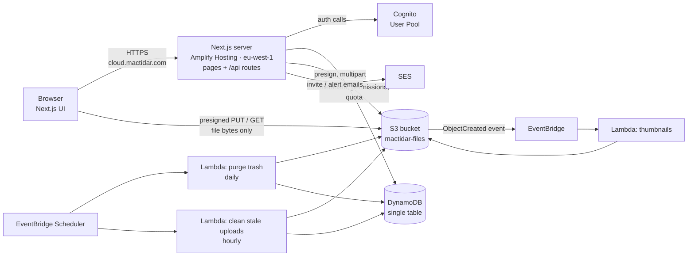
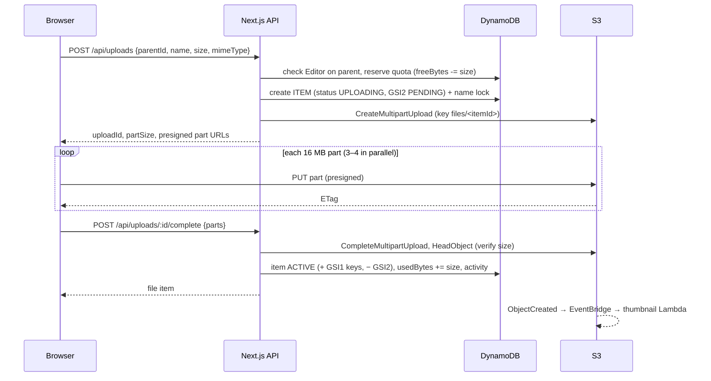

# MacTidar Cloud — Architecture & Data Model

Status: draft v3 · Owner: Ukeme · Infra as code: Terraform · Data: **af-south-1 (Cape Town)** · App: **eu-west-1 (Ireland)** · Domain: **cloud.mactidar.com**

## 1. Goals & constraints
- One team (3 people today), each with their own account. Invite-only, email + password sign-in.
- 15 GB shared team quota, raisable by an admin without a deploy.
- Share files/folders with teammates (Viewer / Editor) and with outsiders via public links (optional password, expiry, download toggle).
- Cheap at low volume, secure by default, everything in Terraform.
- All data and back-end services (S3, DynamoDB, Cognito, SES, Lambdas) run in **af-south-1 (Cape Town)**. The Next.js app runs on **Amplify Hosting in eu-west-1 (Ireland)**, because Amplify isn't available in Cape Town and the alternative (a container + load balancer) costs ~$30/month more.
- Default AWS account, **one environment** (no dev/prod split).
- af-south-1 is an opt-in region: it must be enabled once in the AWS account (Account → AWS Regions) before Terraform can use it.

## 2. High-level architecture



Everything except the Next.js server lives in af-south-1.

**Key principle:** file bytes never pass through our server. The API checks permissions and quota, then hands the browser a short-lived presigned S3 URL. The server only handles small JSON requests, so hosting stays cheap and fast.

| Layer | Choice | Why |
|---|---|---|
| Frontend + API | Next.js (App Router) with Route Handlers under `/api` | One codebase; the server side holds AWS credentials, the browser never does |
| Hosting | **AWS Amplify Hosting** (SSR / `WEB_COMPUTE`) in **eu-west-1** | Managed Next.js hosting, builds from GitHub on push, Terraform support, ~$1–5/month. Amplify doesn't appear to be offered in af-south-1; App Runner closed to new customers on 30 Apr 2026. Server code calls the Cape Town services with AWS SDK clients set to `af-south-1`, using the app's IAM compute role |
| DNS & TLS | Route 53 hosted zone for `cloud.mactidar.com` (delegated from Namecheap); Amplify custom domain issues the certificate | mactidar.com stays at Namecheap; only the subdomain is handed to AWS so Terraform can manage its records |
| Auth | Amazon Cognito User Pool | Managed passwords, reset codes, MFA later. Admin-only user creation |
| Database | DynamoDB, single table, on-demand | Pay-per-request, zero ops, fits key-based access patterns |
| Files | S3, private bucket | Durable, cheap; direct browser upload via presigned URLs |
| Email | Amazon SES | Invite emails, storage alerts |
| Background jobs | Lambda + EventBridge / Scheduler | Thumbnails, trash purge, abandoned-upload cleanup |
| IaC | Terraform (AWS provider 6.x), S3 remote state with native locking | Requested; reproducible dev/prod |

## 3. Authentication

**Cognito setup**
- User pool with `AllowAdminCreateUserOnly = true`, so nobody can self-register.
- Sign-in by email. Password policy: 8+ characters with upper case, lower case, a number and a symbol (matches the invite-page checklist).
- One app client with a client secret, used only by the Next.js server (`ALLOW_USER_PASSWORD_AUTH`, `ALLOW_REFRESH_TOKEN_AUTH`).
- Forgot password uses Cognito's built-in code flow (`ForgotPassword` → `ConfirmForgotPassword`), which matches the 6-digit-code screen.

**Sessions:** the Next.js server calls Cognito, then stores the ID/access token and refresh token in `HttpOnly`, `Secure`, `SameSite=Lax` cookies. Every API request verifies the JWT (`aws-jwt-verify`) and loads the user record from DynamoDB. Tokens never reach browser JavaScript.

**Invite flow** (custom, so we control the email and the "set password" page):
1. Admin submits an email and role. The API creates an `INVITE` record holding a SHA-256 hash of a random 32-byte token, with a 7-day expiry, then emails the link `https://<app>/invite/<token>` via SES.
2. The invitee opens the link. The server looks up the hash and shows the "Accept invitation" page.
3. On submit, the server calls `AdminCreateUser` (no Cognito email), then `AdminSetUserPassword` (permanent), creates the `USER` record and their root "My Files" folder, deletes the invite, and signs them in.

**Roles** are stored on the `USER` record in DynamoDB (`ADMIN` or `MEMBER`). Admins manage members and the quota. **Admins do not get automatic access to other people's files.** They see only what's shared with them.

**Deactivation:** `AdminDisableUser` + `AdminUserGlobalSignOut`, and set `status = DISABLED` in DynamoDB. File hand-over to another member comes in v1.

## 4. Files, folders & permissions model

### 4.1 Items
Files and folders are both **items** with a stable random ID (ULID). Every user has one **root folder** ("My Files"). Each item stores:
- `parentId` — the folder it's in
- `rootId` — the root folder it ultimately belongs to
- `path` — materialised ancestor chain including itself, e.g. `/r1/a7/b3/` (IDs, not names)
- `ownerId` — **the owner of the root**. Anything inside your tree is yours, even if a teammate uploaded it (`createdBy` records who did)

Because S3 keys use the item ID (`files/<fileId>`), **rename and move never touch S3**. They're DynamoDB updates only.

### 4.2 Permission levels
| Action | Viewer | Editor | Owner |
|---|:-:|:-:|:-:|
| View, preview, download | ✅ | ✅ | ✅ |
| Upload, new folder, rename, move (within the shared tree), move to trash | | ✅ | ✅ |
| Share with teammates | | ✅ | ✅ |
| Create, edit or disable a public link | | | ✅ |
| Delete forever, change the owner's own access | | | ✅ |

### 4.3 Access check (runs on every request)
```
effectiveRole(user, item):
  if item.ownerId == user.id            → OWNER
  ids   = ids in item.path              (item + all ancestors, typically < 10)
  grants = BatchGetItem( ITEM#<id> / SHARE#<user.id> for each id )
  return highest role in grants, or NONE
```
That's one `GetItem` plus one `BatchGetItem`, whatever the folder depth, and it's how folder shares cover everything inside the folder.

**Breadcrumbs for shared items** are trimmed at the highest ancestor the user can access, so Tunde sees `Shared with me > Q4 Campaign > Designs`, not Ada's private folders above it.

**MVP rule:** moves are only allowed within the same root (owner's tree). Moving between trees changes ownership; "copy to My Files" will cover that later.

### 4.4 Unique names
Two items in one folder can't share a name. Enforced with a **name-lock record** (`ITEM#<parentId>` / `NAME#<lowercased name>`) written in the same transaction as create, rename and move. Uploads with a clashing name are auto-renamed (`report (1).pdf`).

## 5. DynamoDB single-table design

Table `mactidar`: `PK` (string), `SK` (string). On-demand billing, point-in-time recovery on, deletion protection on, TTL attribute `expiresAt`.

Three overloaded GSIs (all projections `ALL`):
- **GSI1** (`GSI1PK`, `GSI1SK`) — listings: folder contents, members, shared-with-me, invites
- **GSI2** (`GSI2PK`, `GSI2SK`) — time-ordered lists: trash, recent, activity, pending uploads
- **GSI3** (`GSI3PK`, `GSI3SK`) — folder tree: all descendants of a folder

### 5.1 Entities
| Entity | PK | SK | GSI keys | Main attributes |
|---|---|---|---|---|
| Team settings | `TEAM` | `SETTINGS` | — | `quotaBytes`, `usedBytes`, `freeBytes`, `maxFileBytes`, `alertPercent`, `alertSentAt` |
| User | `USER#<userId>` | `PROFILE` | GSI1: `MEMBERS` / `<email>` | `email`, `name`, `role`, `status`, `rootFolderId`, `usedBytes`, `avatarKey`, `lastActiveAt` |
| Invite | `INVITE#<tokenHash>` | `META` | GSI1: `INVITES` / `<createdAt>` | `email`, `role`, `invitedBy`, `expiresAt` (TTL) |
| Item (file/folder) | `ITEM#<itemId>` | `META` | GSI1: `PARENT#<parentId>` / `<0\|1>#<nameLower>` *(only while active)*<br/>GSI2: `TRASH#<trashedBy>` / `<trashedAt>` *(only trash roots)* or `PENDING` / `<createdAt>` *(uploads in progress)*<br/>GSI3: `ROOT#<rootId>` / `<path>` | `type`, `name`, `nameLower`, `parentId`, `rootId`, `path`, `ownerId`, `createdBy`, `size`, `mimeType`, `s3Key`, `status` (`UPLOADING`/`ACTIVE`/`TRASHED`), `trashRootId`, `trashedAt`, `hasThumb`, `createdAt`, `updatedAt`, `updatedBy` |
| Name lock | `ITEM#<parentId>` | `NAME#<nameLower>` | — | `itemId` |
| Share | `ITEM#<itemId>` | `SHARE#<userId>` | GSI1: `SHAREDWITH#<userId>` / `<createdAt>` | `role`, `grantedBy`, `createdAt` |
| Public link | `LINK#<token>` | `META` | — | `itemId`, `createdBy`, `allowDownload`, `passwordHash`, `expiresAt`, `disabled`, `failedAttempts`, `lockedUntil` |
| Link pointer | `ITEM#<itemId>` | `LINK` | — | `token` (so the share dialog can show the current link) |
| Star | `USER#<userId>` | `STAR#<itemId>` | — | `createdAt` |
| Recent | `USER#<userId>` | `RECENT#<itemId>` | GSI2: `RECENT#<userId>` / `<at>` | `action`, `at`, `expiresAt` (30 days) |
| Activity | `ITEM#<itemId>` | `ACT#<at>#<rand>` | GSI2: `TEAMACT#<yyyy-mm>` / `<at>` | `actorId`, `action`, `details`, `expiresAt` (1 year) |

The `0`/`1` prefix in the folder-listing sort key puts folders before files, sorted by name.

### 5.2 Access patterns
| # | Need | How |
|---|---|---|
| 1 | Open a folder (contents) | Query GSI1 `PARENT#<folderId>` |
| 2 | Item details + permission check | GetItem `ITEM#id/META` + BatchGet shares for each id in `path` |
| 3 | Shared with me | Query GSI1 `SHAREDWITH#<me>` → BatchGet item METAs |
| 4 | Recent | Query GSI2 `RECENT#<me>`, newest first |
| 5 | Starred | Query `USER#<me>`, `begins_with(SK, "STAR#")` → BatchGet items |
| 6 | Trash | Query GSI2 `TRASH#<me>` |
| 7 | All descendants (move, trash, zip, restore) | Query GSI3 `ROOT#<rootId>`, `begins_with(GSI3SK, <folder path>)` |
| 8 | People who have access to an item | Query `ITEM#id`, `begins_with(SK, "SHARE#")` (plus ancestors' shares for "inherited") |
| 9 | Members list / share autocomplete | Query GSI1 `MEMBERS` |
| 10 | Pending invites | Query GSI1 `INVITES` |
| 11 | Resolve public link | GetItem `LINK#<token>/META` |
| 12 | Team storage | GetItem `TEAM/SETTINGS`; per-member from `USER` records |
| 13 | Team activity log | Query GSI2 `TEAMACT#<month>` |
| 14 | Stale uploads | Query GSI2 `PENDING`, `GSI2SK < now − 24h` |
| 15 | Search by name | **MVP:** Scan with `contains(nameLower, :q)` filter + permission filter. Fine for tens of thousands of items. Revisit (e.g. OpenSearch) beyond ~50k items |

## 6. Storage quota (15 GB, raisable)
DynamoDB condition expressions can't add two attributes together, so the team record keeps a ready-made **`freeBytes`** counter alongside `quotaBytes` and `usedBytes`.

- **Start upload (reserve):** `UpdateItem TEAM/SETTINGS SET freeBytes = freeBytes - :size IF freeBytes >= :size`. If the condition fails → `413 Storage full`, before a single byte is sent.
- **Complete upload:** `usedBytes += size` on TEAM and on the uploader's USER record (the reservation already reduced `freeBytes`).
- **Abandoned upload / delete forever:** `freeBytes += size` (and `usedBytes -= size` if it was completed).
- **Raise the quota:** admin sets a new limit → `quotaBytes = :new, freeBytes = freeBytes + (:new - :old)` in one conditional update.
- **Max file size:** `maxFileBytes` (default 5 GB), checked at upload start.
- **Alert:** when `usedBytes / quotaBytes` crosses `alertPercent` (80%), email admins once (`alertSentAt`).

Initial values: `quotaBytes = 16,106,127,360` (15 GiB).

Items in the trash still count toward the quota until they're purged.

## 7. Key flows

### 7.1 Upload (multipart, resumable)

- Files under 16 MB use a single presigned `PUT` instead of multipart.
- Presigned URLs live for 15 minutes. The browser can request fresh part URLs (`POST /api/uploads/:id/parts`) to resume after a network drop. Uploaded parts are kept by S3.
- If `HeadObject` size ≠ declared size, the upload is rejected and the reservation released.

### 7.2 Download & preview
API checks Viewer access, then returns a presigned `GET` (5 minutes) with `response-content-disposition` set to the real file name. Previews use the same URL (`inline`). Thumbnails come from `thumbs/<itemId>.webp`.

**Folder as .zip (v1):** API invokes a zip Lambda asynchronously, which streams the folder's files into `tmp/zips/<jobId>.zip` and returns a presigned URL when done. Capped at 10 GB per zip.

### 7.3 Trash & delete forever
- **Move to trash:** the item becomes `TRASHED` with `trashedAt`/`trashedBy`; its GSI1 keys are removed (it disappears from listings) and it gets GSI2 `TRASH#<user>`. For a folder, all descendants (GSI3 query) are marked `TRASHED` with `trashRootId` but only the folder itself appears in Trash.
- **Restore:** reverse the above. If the original parent is gone or trashed, restore to the owner's root.
- **Purge (daily Lambda):** finds trash roots older than 30 days, deletes their S3 objects and thumbnails, deletes the DynamoDB records, and gives the space back to the quota.
- **Delete forever / Empty trash:** same as purge, immediately. Owner only.

### 7.4 Public links
- **Only the item's Owner** can create, change or disable its link.
- Token: 22-character random string (128 bits), URL `https://cloud.mactidar.com/s/<token>`. One active link per item.
- Optional password stored as an **argon2id** hash. After a correct password the server sets a signed, `HttpOnly` cookie for that token (12 h).
- **Brute-force protection:** 10 wrong passwords → link locked for 15 minutes (`failedAttempts`, `lockedUntil`).
- `expiresAt` checked on every request (and used as the TTL, so expired links are deleted automatically).
- For a folder link, every requested item's `path` must contain the linked folder's ID, so visitors can't step outside it.
- `allowDownload = false` → previews only. *(Note: anyone who can view a file in a browser can still save it; this toggle only removes download buttons and zip.)*

### 7.5 Move
Rename is a single transaction (item + name locks). Moving a folder updates the folder in a transaction, then rewrites `path` and `GSI3SK` on every descendant in batches. A folder can't be moved into itself or its own descendants (target `path` must not start with the folder's `path`).

## 8. S3 bucket

Bucket `mactidar-files-<accountId>`:
```
files/<itemId>            original file
thumbs/<itemId>.webp      generated thumbnail
avatars/<userId>.webp     profile photos
tmp/zips/<jobId>.zip      folder downloads (expire after 1 day)
```
- **Block Public Access: all on.** Object Ownership: bucket owner enforced (no ACLs).
- Bucket policy denies non-TLS requests.
- Encryption: SSE-S3 (free). Can switch to SSE-KMS later if required.
- **Versioning on**, with non-current versions expiring after 30 days — a safety net against accidental overwrites and deletes.
- Lifecycle: abort incomplete multipart uploads after 2 days; expire `tmp/` after 1 day.
- CORS: allow `PUT`, `GET`, `HEAD` from `https://cloud.mactidar.com` (and `http://localhost:3000` for local development) only; expose `ETag` (needed to complete multipart uploads).
- EventBridge notifications on, for the thumbnail Lambda.

## 9. API endpoints (Next.js Route Handlers)

All routes require a signed-in user except **Auth** and **Public**. Inputs validated with `zod`.

| Area | Method & path | Purpose | Requires |
|---|---|---|---|
| Auth | `POST /api/auth/login` · `POST /api/auth/logout` | Sign in / out | — |
| | `POST /api/auth/forgot` · `POST /api/auth/reset` | Reset code flow | — |
| | `GET /api/invites/:token` · `POST /api/invites/:token/accept` | Accept invite, set password | valid invite |
| Me | `GET /api/me` · `PATCH /api/me` · `POST /api/me/password` · `POST /api/me/avatar` | Profile & password | signed in |
| Members | `GET /api/members` | Teammate list for share autocomplete | signed in |
| Folders | `GET /api/folders/:id` | Folder info, breadcrumb, contents | Viewer |
| | `POST /api/folders` | New folder | Editor on parent |
| Items | `PATCH /api/items/:id` | Rename / move | Editor (both ends for move) |
| | `GET /api/items/:id/download` | Presigned GET | Viewer |
| | `POST /api/items/:id/trash` · `POST /api/items/:id/restore` | Trash / restore | Editor |
| | `DELETE /api/items/:id` | Delete forever | Owner |
| | `PUT` / `DELETE /api/items/:id/star` | Star / unstar | Viewer |
| | `POST /api/zips` · `GET /api/zips/:jobId` | Folder zip (v1) | Viewer |
| Uploads | `POST /api/uploads` | Start upload (reserve quota) | Editor on parent |
| | `POST /api/uploads/:id/parts` | Fresh part URLs (resume) | uploader |
| | `POST /api/uploads/:id/complete` · `DELETE /api/uploads/:id` | Finish / cancel | uploader |
| Views | `GET /api/shared-with-me` · `/api/recent` · `/api/starred` · `/api/trash` · `/api/search?q=` | Sidebar views | signed in |
| | `POST /api/trash/empty` | Empty trash | Owner of each item |
| Sharing | `GET /api/items/:id/shares` | Who has access (direct + inherited) | Viewer |
| | `PUT` / `DELETE /api/items/:id/shares/:userId` | Grant, change, revoke | Editor |
| | `PUT` / `DELETE /api/items/:id/link` | Create/update, disable public link | Owner |
| Public | `GET /api/public/:token` · `POST /api/public/:token/unlock` | Link info, password | link valid |
| | `GET /api/public/:token/folders/:id` · `GET /api/public/:token/items/:id/download` | Browse & download inside link | link valid (+ unlocked) |
| Admin | `GET /api/admin/members` · `PATCH /api/admin/members/:id` | List, change role, deactivate | Admin |
| | `POST /api/admin/invites` · `POST .../:id/resend` · `DELETE .../:id` | Invites | Admin |
| | `GET /api/admin/storage` · `PATCH /api/admin/settings` | Usage, quota, max file size | Admin |

## 10. Background jobs (Lambda, Node.js 22)
| Function | Trigger | Job |
|---|---|---|
| `thumbnails` | S3 `ObjectCreated` on `files/` via EventBridge | Images → 400 px WebP with `sharp`; sets `hasThumb`. PDF/video thumbs later |
| `purge-trash` | Scheduler, daily 02:00 | Permanently delete trash older than 30 days, release quota |
| `cleanup-uploads` | Scheduler, hourly | Abort uploads stuck > 24 h, release reserved quota |
| `zip-folder` (v1) | Invoked async by API | Stream folder into a zip in `tmp/zips/` |

## 11. Security checklist
- Bucket fully private; all file access via presigned URLs issued after a permission check.
- Next.js server runs with a least-privilege IAM role: only this table, this bucket, these Cognito actions, SES send.
- Tokens in `HttpOnly` cookies; CSRF protection on state-changing routes (`SameSite=Lax` + origin check).
- Security headers (CSP, HSTS, `X-Content-Type-Options`), and previews of user-uploaded HTML/SVG are served as downloads, never rendered inline.
- Secrets (Cognito client secret, cookie signing key) in SSM Parameter Store (SecureString).
- Rate limits on login, forgot-password and link-unlock routes. AWS WAF can be added later.
- Later: GuardDuty Malware Protection for S3, MFA.

## 12. Domain & DNS
- `mactidar.com` stays registered at Namecheap; its existing records are untouched.
- Terraform creates a Route 53 hosted zone for **`cloud.mactidar.com`**. Its 4 name servers are added **once, by hand, in Namecheap** as `NS` records for the host `cloud`. That delegates only the subdomain to AWS.
- Inside that zone, Terraform manages:
  - `cloud.mactidar.com` → Amplify app (records created by the Amplify custom-domain association, including certificate validation)
  - SES domain verification, DKIM, SPF and DMARC records, so invites come from `no-reply@cloud.mactidar.com`
- SES starts in sandbox mode (can only email verified addresses). That's enough for a 3-person team; request production access when invites go to new people regularly.

## 13. Terraform layout
One environment, one state file, default AWS account. The AWS provider defaults to `af-south-1`, with a second aliased provider for `eu-west-1` used only by the hosting module.
```
infra/
  bootstrap/              # one-off: S3 bucket for Terraform state (versioned, encrypted)
  modules/
    dns/                  # Route 53 zone for cloud.mactidar.com
    storage/              # S3 bucket, lifecycle, CORS, policy, EventBridge notifications
    database/             # DynamoDB table, GSIs, TTL, PITR
    auth/                 # Cognito user pool + app client
    email/                # SES domain identity, DKIM/SPF/DMARC records
    hosting/              # Amplify app + master branch (eu-west-1), custom domain, env vars, IAM compute role
    workers/              # Lambdas, IAM roles, EventBridge rules & schedules
    monitoring/           # CloudWatch alarms, AWS Budgets alert
  main.tf                 # wires the modules together
  variables.tf · outputs.tf · versions.tf
  backend.tf              # backend "s3" { use_lockfile = true }
```
- Terraform ≥ 1.10 (S3 native state locking, no DynamoDB lock table) and AWS provider `~> 6.0`.
- Resource names prefixed `mactidar-`.
- **CI (GitHub Actions + AWS OIDC, no stored keys):**
  - Pull request → `terraform fmt`/`validate`/`plan`, plus app lint and tests.
  - Merge to `master` → `terraform apply`. Amplify builds and deploys the Next.js app itself on every push to `master` (connected to the GitHub repo).

## 14. Rough monthly cost (3 users, ≤ 15 GB)
| Service | Estimate |
|---|---|
| Amplify Hosting, eu-west-1 (build minutes + SSR requests + hosting) | ~$1–5 |
| S3, af-south-1 (15 GB + requests) | ~$0.50 |
| DynamoDB on-demand + PITR | < $1 |
| Route 53 hosted zone | $0.50 |
| Cognito (well within free tier) | $0 |
| Lambda, EventBridge, SES, CloudWatch | < $1 |
| Ireland ↔ Cape Town traffic (small JSON API calls only) | < $0.10 |
| **Total** | **≈ $3–8 / month** |

The main variable is downloads: data leaving S3 costs ~$0.15/GB beyond the first 100 GB/month free (shared across all of AWS). A team of 3 is unlikely to reach that. An AWS Budgets alert at $15 is included.

## 15. Decisions
| Topic | Decision |
|---|---|
| Data region | af-south-1 (Cape Town): S3, DynamoDB, Cognito, SES, Lambdas |
| App hosting | Amplify Hosting in eu-west-1 (Ireland). Each page/API request adds ~150–200 ms; file uploads and downloads go straight to Cape Town and aren't affected |
| Domain | `cloud.mactidar.com`, subdomain delegated from Namecheap to Route 53 |
| AWS account | Default account, single environment |
| Public links | Owners only |

---

## 16. Public platform — Phase 1: Workspaces (foundation)

Goal: every piece of data belongs to a **workspace**, so later phases can add self sign-up, personal workspaces and company workspaces. Phase 1 has **no visible change** for the current team: the MacTidar team becomes the first company workspace (`ws-mactidar`).

### 16.1 New and changed records
| Entity | PK | SK | GSI keys | Notes |
|---|---|---|---|---|
| Workspace | `WS#<wsId>` | `META` | — | `name`, `type` (`PERSONAL`/`COMPANY`), `ownerId`, `status`, quota counters (`quotaBytes`, `usedBytes`, `freeBytes`, `maxFileBytes`, `alertPercent`, `alertSentAt`), `externalSharing` (false) — replaces `TEAM/SETTINGS` |
| Membership | `WS#<wsId>` | `MEMBER#<userId>` | GSI1: `USERWS#<userId>` / `<wsId>` | `role` (`ADMIN`/`MEMBER`), `status` (`ACTIVE`/`DISABLED`), `rootFolderId`, `usedBytes`, `joinedAt` |
| User | `USER#<userId>` | `PROFILE` | GSI1: `MEMBERS` / `<email>` (global email lookup) | Global identity only: `email`, `name`, `status`, `sessionVersion`, `notifyShares`. `role`/`rootFolderId`/`usedBytes` move to the membership |
| Item | unchanged | | | + `workspaceId` |
| Share | unchanged | | GSI1: `SHAREDWITH#<wsId>#<userId>` | + `workspaceId` |
| Invite | unchanged | | GSI1: `INVITES#<wsId>` | + `workspaceId` |
| Recent | unchanged | | GSI2: `RECENT#<wsId>#<userId>` | |
| Trash root | unchanged | | GSI2: `TRASH#<wsId>#<userId>` | |

Each member keeps their own root folder **per workspace** (`rootFolderId` on the membership). Existing roots keep their IDs.

### 16.2 Request context
- The signed-in user's **active workspace** is stored in an `HttpOnly` cookie `mt_ws`, validated on every request against an `ACTIVE` membership. If missing or invalid, the first company workspace (else the first workspace) is used.
- Server code receives a *viewer*: the user profile plus the active membership (`workspaceId`, `role`, `rootFolderId`, `usedBytes`). Admin checks use the membership role.
- **Isolation rule:** every item, share, invite, link, search result and stat must have `workspaceId === viewer.workspaceId`; anything else is treated as not found. (Phase 2 adds the controlled exception for guests and outside sharing.)

### 16.3 Quotas
Quota counters live on `WS#<id>/META`; per-member usage on the membership. Uploads reserve against the item's workspace. The cleanup Lambdas use `item.workspaceId`.

### 16.4 Deactivation
Deactivating a member now disables their **membership** in that workspace (they lose access to it) rather than the global Cognito login, because a person may belong to other workspaces.

### 16.5 Migration (`npm run migrate:workspaces`, idempotent, additive)
1. Create `WS#ws-mactidar/META` from `TEAM/SETTINGS` (name "MacTidar", `COMPANY`, owner = first admin).
2. For each user: create the membership (role, usedBytes, rootFolderId from the profile) and its `USERWS#` index entry.
3. Add `workspaceId` to every item, share, invite and link; rewrite the `SHAREDWITH#`, `INVITES#`, `RECENT#` and `TRASH#` index keys.
4. Leave `TEAM/SETTINGS` and the old profile fields in place for rollback; remove them in a later cleanup.
5. Recompute usage from the files themselves (`npm run recompute:usage`) to correct any drift during the switch-over.

Order: run the migration → apply the Lambda update → deploy the app. The migration only adds data, so the old app keeps working until the new one is live.
